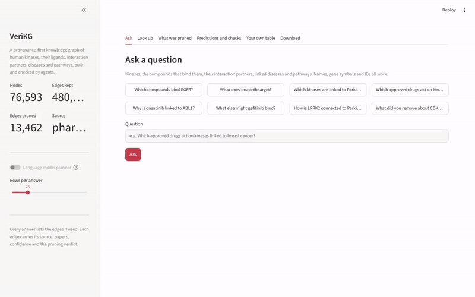
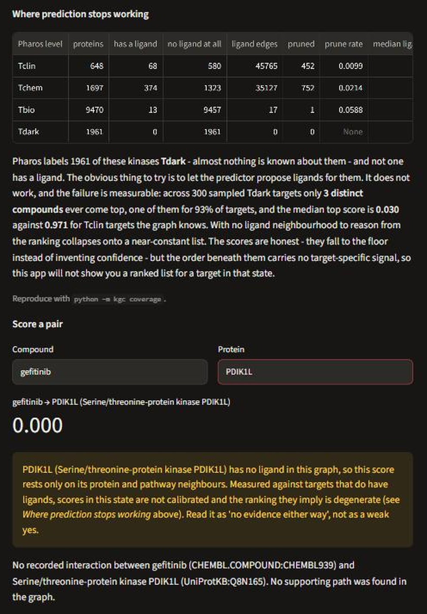
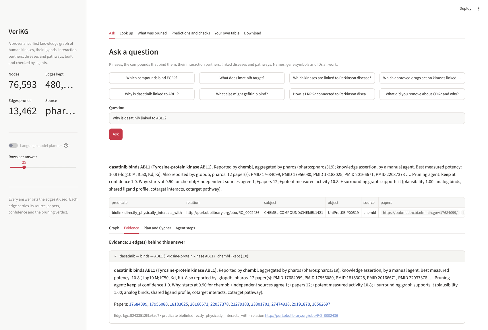
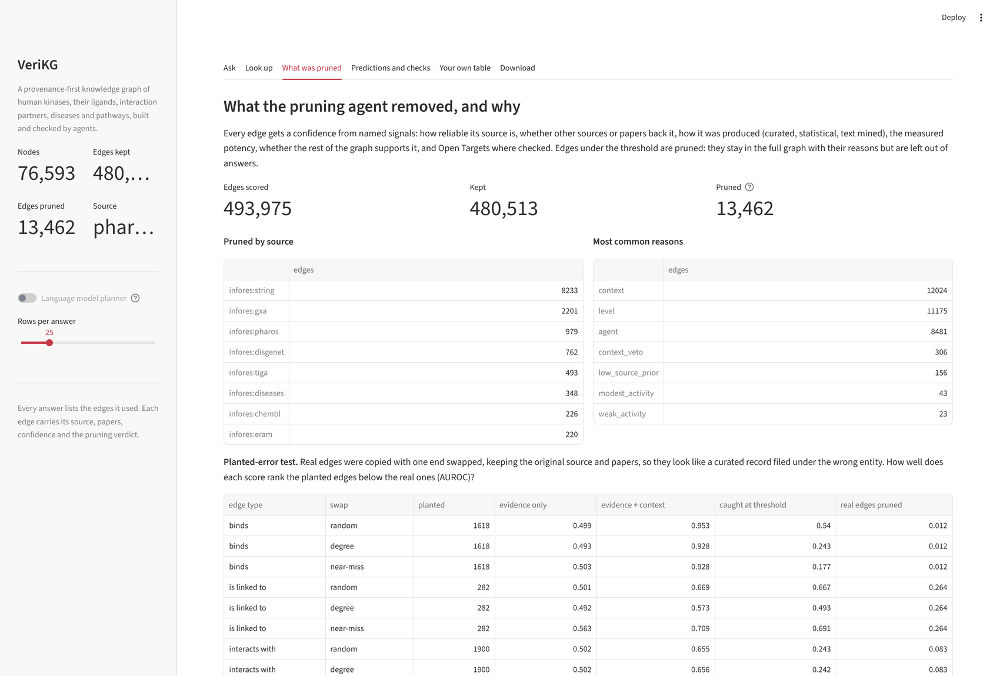
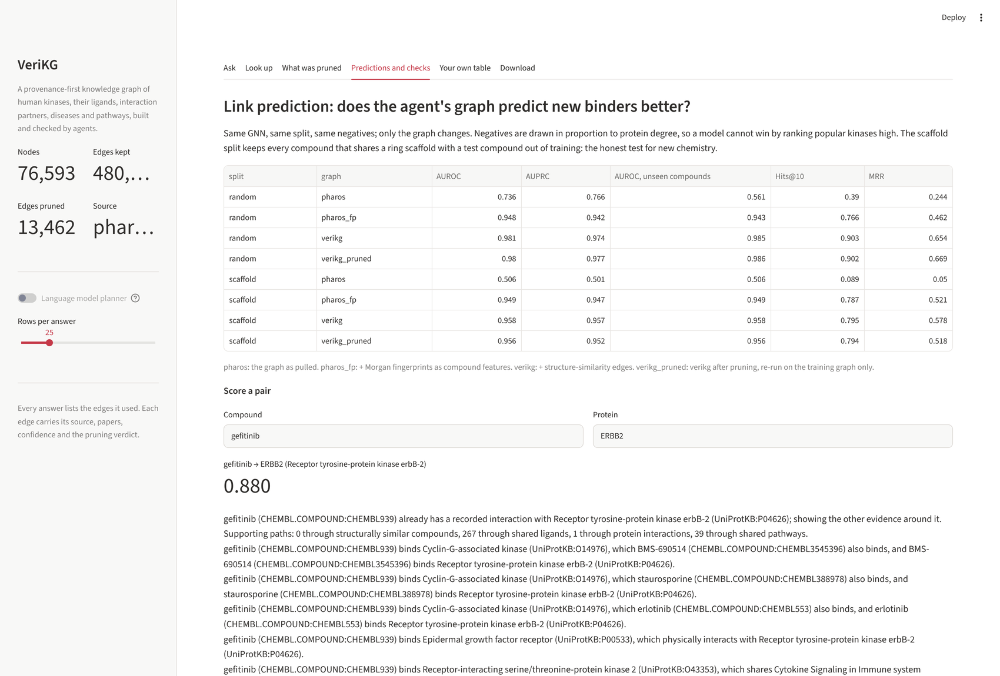
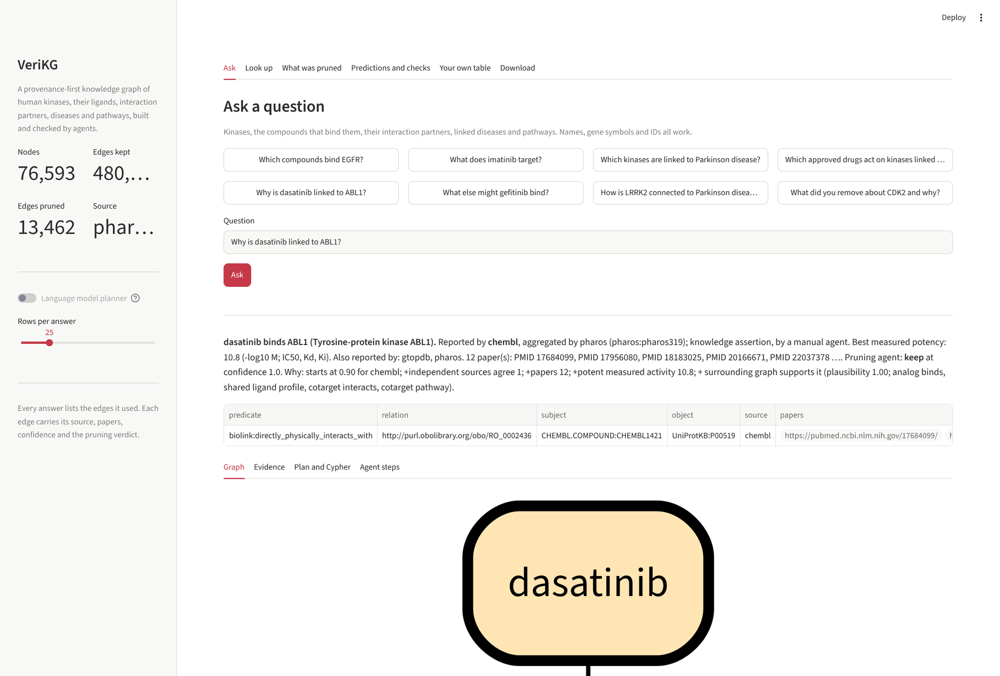

# VeriKG: an agentic, provenance-first biomedical knowledge graph

Entry for the Bio-Agent Knowledge Graph Construction Challenge, Structured Data
Integration and Link Prediction track.

VeriKG turns Pharos/TCRD into a Biolink-compliant knowledge graph of the human
kinome, then lets agents enrich it, score and prune every edge with a
plain-language reason, predict missing ligand-target links, and answer
questions from people who do not write graph queries. Every answer lists the
edges it used, and every edge carries its source, papers, confidence and
verdict.



*A question in plain language, the answer, and the evidence behind it. Full run-through:
[docs/verikg_demo.mp4](docs/verikg_demo.mp4) (52 s, no narration).*

## For the judges

The full write-up is [docs/VeriKG_Final_Report.pdf](docs/VeriKG_Final_Report.pdf). Where to
find each criterion, without installing anything:

| Criterion | What to look at | Headline |
| --- | --- | --- |
| **Usability (40%)** | The screenshots below; [app.py](app.py); `python -m kgc ask --question "..."` | Twelve kinds of question answered in 2-7 s, in plain language, by someone who writes no graph queries. Any CSV becomes a scored KGX graph. |
| **Pruning (30%)** | [The pruning screenshot](#what-the-pruning-agent-removed-and-why); [kgc/prune.py](kgc/prune.py), [kgc/plausibility.py](kgc/plausibility.py), [kgc/benchmark.py](kgc/benchmark.py) | Planted errors that carry a real record's source and papers: evidence alone scores AUROC 0.50, the surrounding graph 0.93-0.95. 32% of them removed at a 1.2% false-prune rate. |
| **Explainability (20%)** | [kgc/explain.py](kgc/explain.py); the Evidence tab above | Full lineage per edge, supporting paths for unrecorded links, the agent's plan and the equivalent Cypher, all shown to the user. |
| **Knowing its own limits** | [The coverage section](#where-the-graph-is-empty-and-where-prediction-stops-working); [kgc/coverage.py](kgc/coverage.py); `python -m kgc coverage` | 13,321 of 13,776 proteins have no ligand. We tested whether the predictor can serve them and report that it cannot: 3 compounds top 300 Tdark targets, median score 0.030 against 0.971. The app refuses to rank where it has no evidence. |
| **Standards (10%)** | [docs/schema.md](docs/schema.md); [kgc/biolink.py](kgc/biolink.py) | Biolink throughout; genes `SO:0001217`, proteins `PR:000000001`, `so#translates_to` between them; relation IRI and infores lineage on every edge; KGX TSV and PyTorch Geometric out. |

Reproducing the numbers takes two commands and about five minutes (below). Every figure in
the report comes from a file in `data/results/`, written by the pipeline, not typed by hand.

## Try it

**Locally** (Python 3.10 or newer) — the prebuilt graph downloads, so this is
running in about five minutes:

```bash
python -m venv .venv
# Windows: .venv\Scripts\activate    macOS/Linux: source .venv/bin/activate
pip install -r requirements.txt
python -m kgc fetch-data        # prebuilt graph, scores and results
python -m kgc app               # http://localhost:8501
```

**On a GPU, in one click:** the [VeriKG Brev Launchable](https://brev.nvidia.com/launchable/deploy?launchableID=env-3MHhl4Tzy8PWfQ8VoHZAuQdHdtW) deploys an
L4 instance with everything installed, the prebuilt graph downloaded and the app
on port 8501. On any other Linux box, `bash brev/setup.sh` does the same; see
[docs/brev.md](docs/brev.md).

Or from the command line:

```bash
python -m kgc ask --question "Which approved drugs act on kinases linked to breast cancer?"
python -m kgc ask --question "Why is dasatinib linked to ABL1?"
python -m kgc ask --question "What did you remove about CDK2 and why?"
```

No API key is needed. With `NVIDIA_API_KEY` set, a NIM model plans the
queries; code still grounds every name to a node ID and runs the query, and
the plan is shown and editable.

## The agents

Both agents are explicit [LangGraph](https://github.com/langchain-ai/langgraph)
state machines (`kgc/agent.py`); every step writes a line to a run log the app
shows.

| Agent | Steps | What a user gets |
| --- | --- | --- |
| Build | ingest, map to Biolink, validate (stop on errors), enrich, prune, export | A KGX graph from Pharos, or from any CSV a researcher uploads, with a verdict on every edge |
| Query | plan, ground names to IDs, clarify if nothing matched, execute | An answer table, the edges behind it drawn as a graph, each edge's lineage, the plan, and the equivalent Cypher |
| Maintain | check the Pharos release, re-pull, diff edge by edge | A changelog of what a new release added, removed or changed |

The query agent covers twelve intents: ligands of a protein, targets of a
compound, proteins for a disease, drugs for a disease (multi-hop through
the disease's genes), diseases of a protein, why two entities are linked,
predicted new targets or ligands, similar compounds, paths between two
entities, what was pruned and why, and an entity summary.

## Results (Pharos 3.19, all 635 kinases)

### The graph

| | |
| --- | --- |
| Nodes | 76,593: 58,702 small molecules, 125 approved drugs, 13,776 proteins, 635 genes, 2,303 diseases, 1,052 pathways |
| Source edges | 198,491: 80,909 ligand-protein, 95,012 protein-protein, 14,114 gene-disease, 7,689 protein-pathway, 635 gene-protein, 132 drug-indication |
| Added by enrichment | 295,484 structure-similarity edges (Morgan fingerprints, Tanimoto >= 0.6, 10 nearest neighbours) |
| Validator | 0 errors, 0 warnings |
| Dropped at ingest | 566 disease records Pharos gave no usable identifier for, and 29 chemicals with no structure (counted in `pharos_kinase_stats.json`) |

### Pruning

Every edge gets a confidence in [0, 1] from named signals: the reliability of
its most reliable source, corroboration by the others, papers, how the knowledge was
produced (curated, statistical, text mined, computed), measured potency or
interaction score, and context plausibility, a model of whether the rest of
the graph, without the edge, still points to it (scored out of fold, so no
edge contributes to its own score). Edges under 0.45 are pruned. They stay in
the full graph with their reasons and are left out of answers. Of 493,975
edges, 13,462 are pruned:

| | Edges | Pruned | Main reasons |
| --- | --- | --- | --- |
| Ligand-protein | 80,909 | 1,205 (1.5%) | the record names no upstream source and the surrounding graph does not support it (899); the surrounding graph contradicts it (306, the context veto) |
| Protein-protein | 95,012 | 8,233 (8.7%) | STRING only, computed, and the two proteins share no partners, pathways or ligands |
| Gene-disease | 14,114 | 4,024 (28.5%) | statistical association only (Expression Atlas 2,201, DisGeNET 762, TIGA 493, text mining 348, eRAM 220) with no support from the gene's interaction partners or pathways |
| Pathway, gene-protein, indication | 8,456 | 0 | curated |

**Planted-error test.** For each edge type, 2% of its edges are copied three
times, once per kind of swap, with one end swapped and the original source,
papers and potency kept, so each planted edge looks like a curated record
filed under the wrong entity. Evidence scoring alone
cannot see these (AUROC 0.50, as designed); context can:

| Edge type | Planted | AUROC, evidence only (mean of the three swaps) | AUROC, evidence + context (random / degree / near-miss swaps) | Planted edges pruned | Real edges pruned | Precision of pruning |
| --- | --- | --- | --- | --- | --- | --- |
| Ligand-protein | 4,854 | 0.50 | 0.953 / 0.928 / 0.928 | 32.0% | 1.2% | 61.0% |
| Gene-disease | 846 | 0.52 | 0.669 / 0.573 / 0.709 | 61.7% | 26.4% | 12.3% |
| Protein-protein | 5,700 | 0.50 | 0.655 / 0.656 / 0.612 | 22.7% | 8.3% | 14.2% |
| Protein-pathway | 459 | 0.50 | 0.813 / 0.734 / 0.678 | 0.0% | 0.0% | nothing pruned |
| Drug-indication | 30 | 0.50 | 0.771 / 0.666 / 0.297 | 0.0% | 0.0% | nothing pruned |

The context veto applies where the context model is strong (ligand-protein
edges: out-of-fold AUROC 0.98 against corrupted copies). It flags an edge
that is less plausible than three quarters of random mix-ups and has enough
surrounding graph to judge by; on the real graph that is 306 edges (0.4%;
226 from ChEMBL, 82 without a paper), candidates for review rather than
proven errors. Near-miss swaps (the compound
filed under an interaction partner or pathway mate of the true kinase) are
the hardest, as they should be.

### Link prediction

Same model (two-layer heterogeneous GraphSAGE), same split, same negatives;
only the graph changes. Negatives are drawn in proportion to protein degree,
so ranking popular kinases high earns nothing (a degree-only score gets
0.51). Hits@10 and MRR rank each true pair against 99 such negatives.

| Split | Graph | AUROC | AUPRC | AUROC, compounds unseen in training | Hits@10 | MRR |
| --- | --- | --- | --- | --- | --- | --- |
| random | `pharos` | 0.736 | 0.766 | 0.561 | 0.390 | 0.244 |
| random | `pharos_fp` | 0.948 | 0.942 | 0.943 | 0.766 | 0.462 |
| random | `verikg` | 0.981 | 0.974 | 0.985 | 0.903 | 0.654 |
| random | `verikg_pruned` | 0.980 | 0.977 | 0.986 | 0.902 | 0.669 |
| random | feature baseline (logistic regression) | 0.709 | 0.749 | | 0.514 | 0.327 |
| scaffold | `pharos` | 0.506 | 0.501 | 0.506 | 0.089 | 0.050 |
| scaffold | `pharos_fp` | 0.949 | 0.947 | 0.949 | 0.787 | 0.521 |
| scaffold | `verikg` | 0.958 | 0.957 | 0.958 | 0.795 | 0.578 |
| scaffold | `verikg_pruned` | 0.956 | 0.952 | 0.956 | 0.794 | 0.518 |
| scaffold | feature baseline (logistic regression) | 0.486 | 0.485 | | 0.285 | 0.110 |

`pharos` is the graph as pulled; `pharos_fp` adds Morgan fingerprints as
compound features; `verikg` adds the structure-similarity edges; and
`verikg_pruned` is verikg after the pruning agent, re-run on the training
graph alone so no test edge influences what is cut.

**Seed stability.** The table is seed 0. Repeating the random split with a
second training seed reproduces VeriKG exactly (AUROC 0.981, Hits@10 0.903
both times) and moves the source graph a little (0.736 to 0.741). The
scaffold split is less stable: VeriKG scored 0.958 on seed 0 and 0.914 on
seed 1, and on seed 1 validation AUROC was still climbing when training hit
the 120-epoch cap, so part of that gap is undertraining rather than noise.
Read the scaffold row as *roughly 0.91 to 0.96 against 0.51 for the source
graph*, not as three decimal places. Reproduce with `--seed 1`; the seed 1 runs ship as `data/results/pharos_kinase_gnn_seed1.json` and `*_scaffold_gnn_seed1.json`, and every GNN entry records the `seed` and `epoch_cap` it came from.

The enrichment is what carries prediction: on the random split it lifts
AUROC from 0.736 to 0.981 and Hits@10 from 0.39 to 0.90. Pruning leaves
link prediction where it was (0.980 against 0.981 on the random split, 0.956
against 0.958 on the scaffold split): both gaps are smaller than the
seed-to-seed variation above, so pruning removes 13,462 edges to make the
graph more precise at no measurable cost to prediction.

The **scaffold split** is the honest test for new chemistry: no test compound
shares a Bemis-Murcko scaffold with any training compound, so every test pair
involves a compound the model has never seen bound to anything. The source
graph alone has no signal there (`pharos` at 0.506, the feature baseline at
0.486), which is why enrichment matters. Accuracy falls as test compounds
get less similar to anything in training. The similarity edges help where a
neighbour at Tanimoto 0.6 or more exists and cost a little between 0.4 and
0.6 (the 164 pairs under 0.4 are too few to read):

| Max Tanimoto of the test compound to any training compound | <0.4 | 0.4-0.6 | 0.6-0.8 | >=0.8 |
| --- | --- | --- | --- | --- |
| Test pairs (positives and negatives) | 164 | 2,184 | 9,736 | 4,080 |
| `pharos` AUROC | 0.573 | 0.507 | 0.506 | 0.503 |
| `pharos_fp` AUROC | 0.720 | 0.839 | 0.958 | 0.974 |
| `verikg` AUROC | 0.764 | 0.806 | 0.969 | 0.979 |
| `verikg_pruned` AUROC | 0.708 | 0.819 | 0.966 | 0.976 |

### Where the graph is empty, and where prediction stops working

Pharos exists to illuminate understudied targets, so it labels every protein with a
target development level. Those labels travel onto our protein nodes, which lets us
check the two things an IDG reviewer would actually want checked.

**Does pruning fall evenly across the four levels?** An agent that quietly deleted the
understudied end of the graph would look good on aggregate metrics while doing real
harm.

| Pharos level | Proteins | Have a ligand | No ligand at all | Ligand edges | Pruned | Prune rate | Median ligands, of targets that have any |
| --- | --- | --- | --- | --- | --- | --- | --- |
| Tclin | 648 | 68 | 580 | 45,765 | 452 | 0.99% | 405 |
| Tchem | 1,697 | 374 | 1,323 | 35,127 | 752 | 2.14% | 11 |
| Tbio | 9,470 | 13 | 9,457 | 17 | 1 | 5.88% | 1 |
| Tdark | 1,961 | 0 | 1,961 | 0 | - | - | - |

The rate doubles from Tclin to Tchem, and we report that rather than bury it: a
Tchem binding claim is likelier to rest on a single assay from a lower-tier source,
which is exactly what the confidence model marks down. The apparent 5.88% at Tbio is
one pruned edge out of seventeen and should not be read as a rate at all. The
distribution is also the honest headline about the graph: **evidence is concentrated
in a few hundred well-studied kinases**, and 13,321 of 13,776 proteins carry no
ligand whatsoever.

**Can the predictor say anything about the targets that have none?** This is the
tempting claim - 1,961 Tdark kinases, 1,947 of which do have protein-interaction or
pathway context, so the model has *something* to reason from. We ran it, and the
answer is no:

| | Ligand-less Tdark targets | Tclin targets with ligands |
| --- | --- | --- |
| Median top-1 score | **0.030** | **0.971** |
| Share scoring above 0.5 | 0.7% | - |
| Distinct compounds taking the top slot (300 sampled) | **3** | - |
| Largest share taken by one compound | **93%** | - |

Three compounds come top for three hundred different targets, one of them for 93% of
them - and those compounds each bind a single kinase in the graph, so this is not even
popularity bias. With no ligand neighbourhood to reason from, the ranking collapses
onto a near-constant list.

Read the two halves separately, because they point in opposite directions. The
**scores are honest**: they fall to the floor where the graph is empty, two orders of
magnitude below the calibrated range, so the model does not manufacture confidence it
has not earned. The **ranking underneath them is not usable**, and no amount of
presentation fixes that. So the app refuses to show a ranked list for a target in
that state and labels any single score for one as "no evidence either way" rather
than a weak yes.



We would rather ship this negative result than a shortlist of dark-kinome
"candidates" that a reviewer could not distinguish from noise. `python -m kgc
coverage` reproduces every number above.

## The answer, with its evidence



Every answer names the edges it used. Every edge carries its source, its papers, its
confidence and why the pruning agent kept or cut it.

## What the pruning agent removed, and why



## Link prediction, side by side



## The evidence behind an answer, drawn



## Standards

- **Biolink** categories and predicates throughout, with domain and range
  checked by the validator; genes typed `SO:0001217`, proteins `PR:000000001`,
  and an ontology class on every node (`type_iri`).
- **Relation IRI on every edge** (RO terms where they exist).
- **Lineage on every edge**: `primary_knowledge_source` and
  `aggregator_knowledge_source` (infores CURIEs), `knowledge_level`,
  `agent_type`, `publications`, `supporting_sources`, `source_version`,
  `ingest_run`; computed edges name `infores:verikg` as their source.
- **KGX TSV** for every graph; a **PyTorch Geometric** `HeteroData` file with
  edge confidence and a keep mask on every edge type; numpy arrays for any
  extracted subgraph.

See [docs/schema.md](docs/schema.md) for every class and predicate.

## Build it yourself

```bash
pip install -r requirements.txt
pip install -r requirements-gnn.txt   # only for the GNN steps

python -m kgc pull                    # all 635 kinases from the Pharos API, about an hour; resumable
python -m kgc all                     # build, validate, split, feature baseline
python -m kgc enrich                  # fingerprints and similarity edges, about 10 min
python -m kgc opentargets             # optional: Open Targets scores for gene-disease edges (network)
python -m kgc prune                   # confidence, verdict and reasons on every edge
python -m kgc benchmark               # planted-error test
python -m kgc split-scaffold          # scaffold split
python -m kgc gnn                     # link prediction, random split
python -m kgc gnn --split scaffold
python -m kgc predict                 # model for the app, plus the PyG export
python -m kgc coverage                # ligand coverage by Pharos level, and the prediction floor
python -m kgc app
```

`python -m kgc pull --limit 5` followed by the same steps is a quick smoke
test. `python -m kgc table --file my_table.csv` runs the build agent on any
relationship table. `python -m kgc update` checks Pharos for a new release.

Main outputs (`data/`, git-ignored):

| Path | Contents |
| --- | --- |
| `raw/pharos_kinase.jsonl` | Untouched API responses, one target per line, plus `.meta.json` with the Pharos version |
| `kgx/pharos_kinase_{nodes,edges}.tsv` | The source graph in KGX TSV |
| `kgx/pharos_kinase_edges_scored.tsv` | Every edge, enrichment included, with confidence, notes, verdict and reasons |
| `kgx/pharos_kinase_edges_pruned.tsv` | The pruned graph (kept edges only) |
| `kgx/pharos_kinase_verdicts.tsv` | Every Pharos edge with its verdict, confidence and reasons, gene and protein ends as UniProt IDs |
| `kgx/pharos_kinase_pyg.pt` | PyTorch Geometric HeteroData of the scored graph |
| `results/` | Baselines, GNN comparisons, planted-error benchmark |

Run the tests with `python -m pytest -q tests`. They use synthetic records
only; no network needed.

## Design decisions

- **Raw first.** API responses are stored untouched, so ID mapping can change without downloading again.
- **Activities scoped to their target, and credited to their source.** Pharos can return a ligand's activities against other targets; only the parent target's are kept. An activity whose reference is a journal citation on a ChEMBL compound is credited to ChEMBL, mechanism-of-action rows to DrugCentral.
- **Drug indications are not gene-disease evidence.** Pharos lists DrugCentral indications among disease associations; they become drug-disease edges instead.
- **One ID per compound.** When Pharos lists several ChEMBL IDs for one ligand, the first is the node ID and the rest are kept as `xref`.
- **Nothing is deleted.** Pruning writes a verdict and reasons; the full graph and the pruned graph are both written so they can be compared.
- **Fair evaluation.** Held-out pairs are removed from the training graph under every predicate and both directions; negatives are type-constrained and degree-matched; a scaffold split tests new chemistry; pruning for the GNN comparison is re-run on the training graph only.
- **Language models propose, code decides.** A model may plan a query or suggest a table mapping; every step that admits data or computes an answer is deterministic code.

## Data and licenses

Code: MIT. Data come from Pharos/TCRD and its upstream sources (ChEMBL,
DrugCentral, Guide to Pharmacology, STRING, BioPlex, Reactome, DisGeNET,
JensenLab, Expression Atlas and others), each under its own license; see the
[Pharos data sources](https://pharos.nih.gov/about). The prebuilt data
download is provided for evaluating this entry; please respect the upstream
licenses when redistributing derived graphs.
